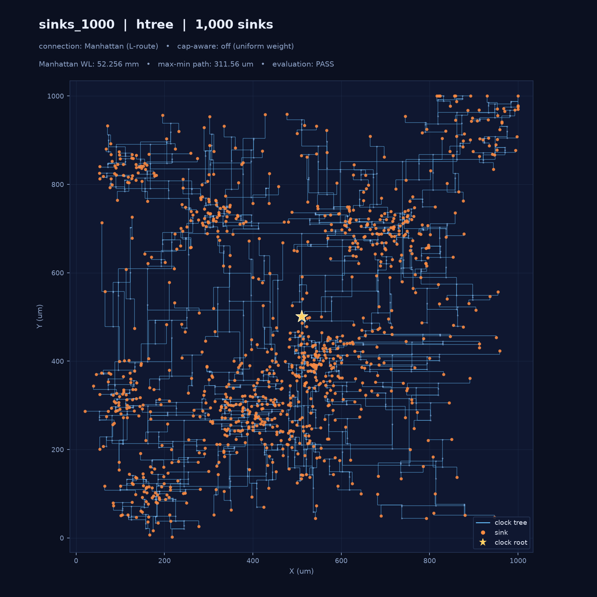
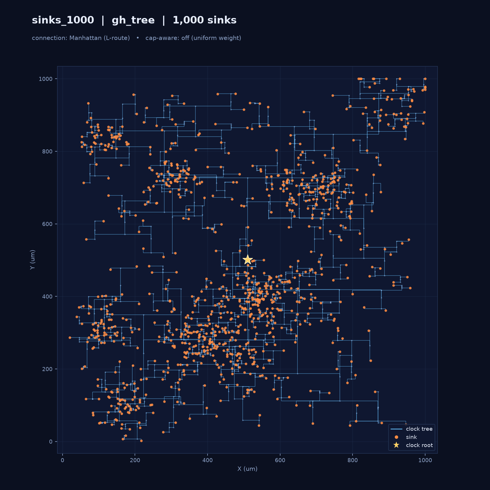
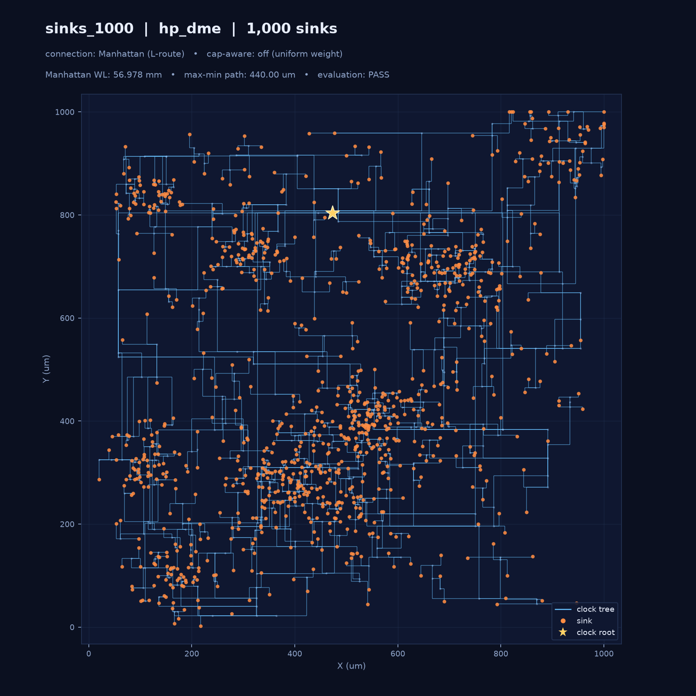
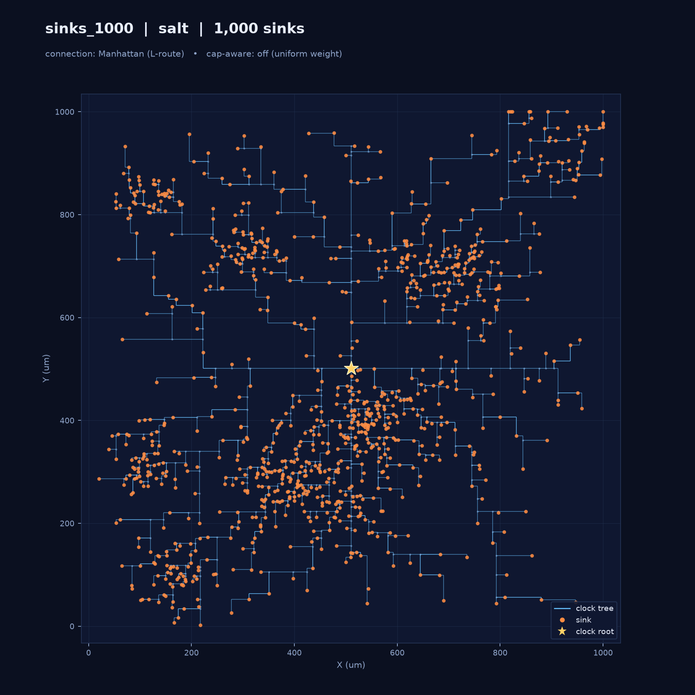
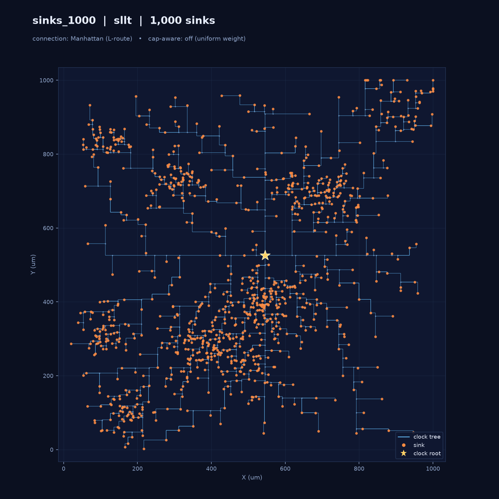
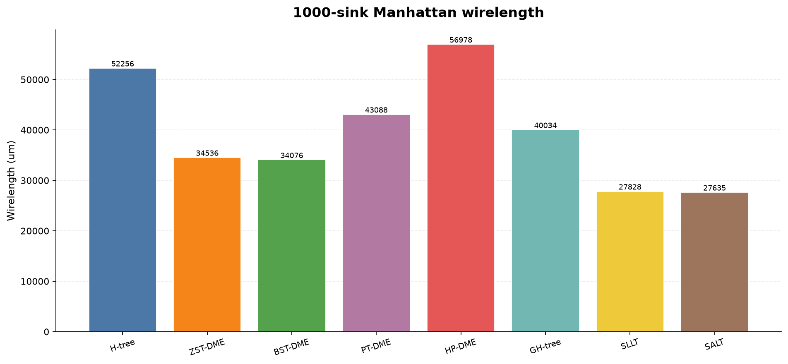
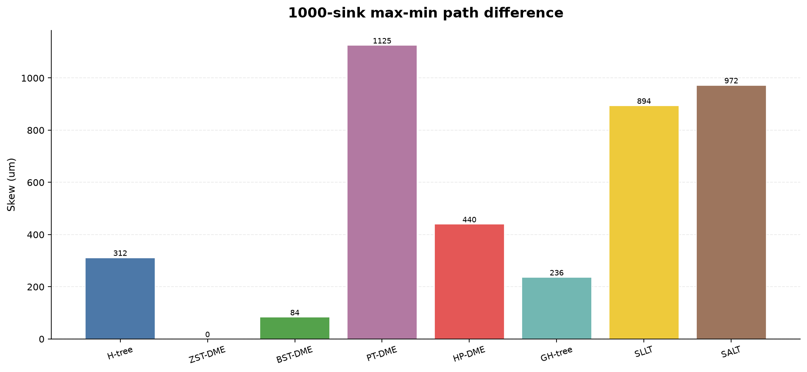
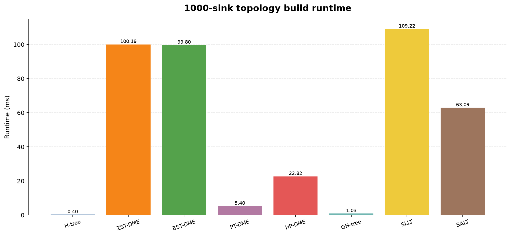

# CTS Topology

面向 EDA / Clock Tree Synthesis 的拓扑构造实验项目。项目实现了
6种经典的 clock tree / clock routing 拓扑（不保证标准啊），每种拓扑都有独立源文件和独立可执行文件，
并配套了平面 sink case 生成、Manhattan 线长/路径评估、可视化和批量实验脚本。

> 仓库：<https://github.com/tfcdys/cts-topology>
>
> 结果目录 `results/` 不提交到仓库；运行 `make experiments` / `run_cts.sh`
> 可在本地重新生成。README 中只保留少量用于展示的图片和汇总表。

## 目录

- [项目内容](#项目内容)
- [8 种拓扑与算法来源](#8-种拓扑与算法来源)
- [构建](#构建)
- [运行](#运行)
- [评估与输出](#评估与输出)
- [初步实验结果](#初步实验结果)
- [测试](#测试)
- [复现实验](#复现实验)
- [仓库结构](#仓库结构)
- [文档](#文档)
- [限制与说明](#限制与说明)
- [第三方组件与许可证](#第三方组件与许可证)

## 项目内容

- 6 种拓扑：H-tree、ZST-DME、BST-DME、GH-tree、SALT、SLLT；PT-DME、HP-DME是自己弄着玩儿的，不必在意。
- 输入：带电容和二维坐标的平面 sink case（CSV）。
- 输出：rooted clock tree（节点、边、sink 映射）JSON。
- 评估：sink 覆盖率、完整树、单根无环、Manhattan 总线长、最大/最小
  root-to-sink 路径、skew。
- 可视化：欧式/Manhattan L 型连线；。
- 实验：16/100/1000 sink 的 8 算法对比，5 次重复取中位数。
- 测试：0–5 节点、1000 random、collinear、duplicate、确定性等。

## 8 种拓扑与算法来源

| 拓扑 | 类型 / 思路 | 来源与参考 |
|---|---|---|
| **H-tree** | 自适应四叉 H-tree | 经典 H-tree 结构，本项目独立实现 |
| **ZST-DME** | Zero-Skew Tree + DME | <https://github.com/geziangfinn/ZSTDME> |
| **BST-DME** | Bounded-Skew Tree + DME | <https://github.com/abk-openroad/BST-DME> |
| **GH-tree** | K-means 四区域 + 递归 generalized H-tree | <https://github.com/The-OpenROAD-Project/TritonCTS> |
| **SALT** | FLUTE SMT + shallow-light Steiner 后处理 | <https://github.com/OSCC-Project/iEDA/tree/master/src/operation/iCTS>、<https://github.com/chengengjie/salt> |
| **SLLT** | BST-DME 与 SALT 融合 | iEDA/iCTS `bstSaltTree`，见 [docs/salt_sllt_implementation.md](docs/salt_sllt_implementation.md) |
| **PT-DME** | Delaunay + 贪心极大独立集 + 并行三元 DME | 本项目 [docs/pt-dme.md](docs/pt-dme.md) |
| **HP-DME** | 路径感知三元合并 + 离群点四终端 H-tree | 本项目 [docs/hp_dme_opti.md](docs/hp_dme_opti.md) |

依赖：

- Delaunay：vendored [Delaunator-C++](third_party/delaunator.hpp)（MIT）。
- SALT：vendored [SALT](third_party/salt/)（MIT）。
- FLUTE：vendored [FLUTE3](third_party/flute3/)（BSD 3-Clause）。
- SALT 后处理使用 Boost.Geometry 头文件。

## 构建

要求：

- C++17 编译器（`g++` 11+ 验证）
- GNU Make
- Python 3.10+（评估/可视化）
- matplotlib（可视化）
- Boost headers（SALT refine）

```bash
make -j

python3 -m venv .venv
.venv/bin/pip install -r requirements.txt
```

生成的可执行文件：

```text
build/h_tree
build/zst_dme
build/bst_dme
build/pt_dme
build/hp_dme
build/gh_tree
build/salt
build/sllt
build/case_gen
```

SALT/FLUTE 的 LUT 路径是相对路径 `third_party/flute3/etc/`，因此请从仓库根目录
运行二进制；`run_cts.sh` 会自动 `cd` 到仓库根目录。

## 运行

### 直接运行单个拓扑

```bash
./build/h_tree  --case sinks_1000
./build/zst_dme --case sinks_100
./build/bst_dme --case sinks_100 --skew-bound 100
./build/pt_dme  --case sinks_1000
./build/hp_dme  --case sinks_1000
./build/gh_tree --case sinks_1000
./build/salt    --case sinks_1000
./build/sllt    --case sinks_1000
```

### 一键执行：构造 + 评估 + 可视化

```bash
./run_cts.sh --case sinks_1000 --topology htree
./run_cts.sh --case sinks_1000 --topology pt_dme
./run_cts.sh --case sinks_1000 --topology gh_tree
./run_cts.sh --case sinks_1000 --topology salt
./run_cts.sh --case sinks_1000 --topology sllt
```

case 名形如 `sinks_N` 且文件不存在时，`run_cts.sh` 会自动生成 N 个 sink；
也可以用 `--count N` 明确指定。

### 生成 case

```bash
./build/case_gen generate-all --force
./build/case_gen generate --case sinks_500 --count 500
```

当前 `data/cases/` 包含 20、50、100、1000、10000、100000 sink 标准 case，
以及 12×12 点阵对应的 `sinks_grid16`。

## 评估与输出

评估器：

```bash
.venv/bin/python scripts/evaluate_topology.py \
  --topology results/htree_sinks_1000.json \
  --case-file data/cases/sinks_1000.csv \
  --json-out results/htree_sinks_1000.eval.json \
  --report-out results/htree_sinks_1000.eval.txt
```

评估内容：

- sink 覆盖率
- rooted tree 完整性
- 单根、无环、全节点可达
- sink 是否为叶节点
- Manhattan 总线长
- 最大 / 最小 root-to-sink 路径
- max−min path difference（skew）
- 算法构建耗时（来自拓扑 JSON 的 `build_runtime_ms`）

可视化：

```bash
.venv/bin/python scripts/visualize_topology.py \
  --input results/htree_sinks_1000.json --mode both --outdir results
```

输出策略：

- 通用拓扑：欧式图、Manhattan 图、`.eval.json`、`.eval.txt`。
- `gh_tree` / `salt` / `sllt`：按实验要求**只输出 Manhattan 图 + `_report.txt`**，
  不输出欧式图和 `.eval.json`。
- `run_cts.sh` 会自动处理这个策略，并强制 Manhattan 模式。
- report.txt 中包含 `Algorithm runtime`。

## 初步实验结果

实验设置：

- 8 种算法 × 16 / 100 / 1000 sink
- 电容感知关闭，所有 sink cap 视为统一权重
- BST-DME 全局 skew bound = 100um
- 运行时间为 builder 内部耗时，重复 5 次取中位数
- 机器：本地 12 线程

### 1000-sink 结果

| Algorithm | Nodes/Edges | WL (um) | Max path (um) | Min path (um) | Skew (um) | Runtime (ms) |
|---|---:|---:|---:|---:|---:|---:|
| H-tree | 2008/2007 | 52255.853 | 1175.999 | 864.435 | 311.564 | 0.400 |
| ZST-DME | 2017/2016 | 34536.295 | 924.139 | 924.139 | 0.000 | 100.191 |
| BST-DME (B=100) | 1999/1998 | 34075.794 | 949.139 | 865.500 | 83.638 | 99.803 |
| GH-tree | 2485/2484 | 40033.837 | 1024.869 | 788.418 | 236.451 | 1.029 |
| SLLT | 1997/1996 | 27828.324 | 929.139 | 34.876 | 894.263 | 109.219 |
| SALT | 1997/1996 | 27634.601 | 988.707 | 16.342 | 972.365 | 63.093 |
| PT-DME | 1500/1499 | 43088.005 | 1934.805 | 809.555 | 1125.250 | 5.401 |
| HP-DME | 1542/1541 | 56978.416 | 1254.971 | 814.972 | 439.999 | 22.824 |

所有结果均通过覆盖率、完整树、单根无环和 sink 叶节点检查。

### 可视化

| H-tree | GH-tree |
|---|---|
|  |  |
| **HP-DME** | **SALT** |
|  |  |

SLLT：



### 线长与 skew 对比







### 观察

- **ZST-DME / BST-DME** 在 1000 sink 上具有最低线长和最低 skew，但 NNG 拓扑
  构建较慢（约 100ms）。
- **SALT** 的线长最低（27634.601um），但 shallow-light 目标不保证低 skew，
  1000 sink 的 min path 只有 16.342um。
- **SLLT** 用 BST 作为 SALT 融合的种子，1000 sink 的线长为 27828.324um、
  max path 929.139um，但仍不保持 BST 的 skew bound。
- **GH-tree** 在 H-tree/PT-DME/HP-DME 中具有最低的 1000-sink 线长、max path
  和 skew，且构建约 1ms。
- **HP-DME** 相对 PT-DME 将 max path 从 1934.805 降到 1254.971um，skew 从
  1125.250 降到 439.999um，代价是线长增加约 32%。
- **H-tree** 构建最快（0.4ms），但线长和 skew 明显高于 DME/SALT 系列。

<details>
<summary>完整 16 / 100 / 1000 sink 结果表</summary>

| Algorithm | Case | Nodes/Edges | WL (um) | Max path | Min path | Skew | Runtime (ms) |
|---|---|---:|---:|---:|---:|---:|---:|
| H-tree | 16 | 31/30 | 4416.667 | 833.333 | 750.000 | 83.333 | 0.006 |
| H-tree | 100 | 195/194 | 14711.230 | 1267.637 | 714.660 | 552.977 | 0.034 |
| H-tree | 1000 | 2008/2007 | 52255.853 | 1175.999 | 864.435 | 311.564 | 0.400 |
| ZST-DME | 16 | 31/30 | 4291.667 | 750.000 | 750.000 | 0.000 | 0.033 |
| ZST-DME | 100 | 199/198 | 7880.606 | 775.274 | 775.274 | 0.000 | 0.280 |
| ZST-DME | 1000 | 2017/2016 | 34536.295 | 924.139 | 924.139 | 0.000 | 100.191 |
| BST-DME (B=100) | 16 | 31/30 | 4301.667 | 790.000 | 730.000 | 60.000 | 0.032 |
| BST-DME (B=100) | 100 | 199/198 | 7913.689 | 791.941 | 743.744 | 48.197 | 0.279 |
| BST-DME (B=100) | 1000 | 1999/1998 | 34075.794 | 949.139 | 865.500 | 83.638 | 99.803 |
| GH-tree | 16 | 31/30 | 4416.667 | 833.333 | 750.000 | 83.333 | 0.011 |
| GH-tree | 100 | 247/246 | 9728.442 | 1121.131 | 480.548 | 640.584 | 0.078 |
| GH-tree | 1000 | 2485/2484 | 40033.837 | 1024.869 | 788.418 | 236.451 | 1.029 |
| SLLT | 16 | 30/29 | 4250.002 | 770.001 | 396.667 | 373.334 | 0.166 |
| SLLT | 100 | 197/196 | 6293.011 | 775.276 | 8.340 | 766.936 | 1.358 |
| SLLT | 1000 | 1997/1996 | 27828.324 | 929.139 | 34.876 | 894.263 | 109.219 |
| SALT | 16 | 30/29 | 4166.669 | 750.001 | 416.667 | 333.334 | 25.923 |
| SALT | 100 | 197/196 | 6501.059 | 871.419 | 17.974 | 853.445 | 27.768 |
| SALT | 1000 | 1997/1996 | 27634.601 | 988.707 | 16.342 | 972.365 | 63.093 |
| PT-DME | 16 | 24/23 | 5833.333 | 1302.083 | 447.917 | 854.167 | 0.855 |
| PT-DME | 100 | 150/149 | 11471.135 | 1646.126 | 640.987 | 1005.140 | 2.238 |
| PT-DME | 1000 | 1500/1499 | 43088.005 | 1934.805 | 809.555 | 1125.250 | 5.401 |
| HP-DME | 16 | 24/23 | 6666.667 | 756.348 | 660.319 | 96.029 | 0.750 |
| HP-DME | 100 | 162/161 | 15814.219 | 1084.992 | 470.370 | 614.621 | 2.223 |
| HP-DME | 1000 | 1542/1541 | 56978.416 | 1254.971 | 814.972 | 439.999 | 22.824 |

</details>

## 测试

```bash
make test
```

测试套件：

- PT-DME：0–5、1000 random、skewed、collinear、duplicate、并行确定性。
- HP-DME：0–5、1000 random/skewed/collinear/duplicate、离群点、并行确定性。
- GH-tree：0–5、1000 random/collinear/duplicate、确定性。
- SALT/SLLT：0–5、1000 random/collinear/duplicate、确定性。

当前全部通过。

## 复现实验

```bash
make experiments
```

脚本对 8 种算法在 `sinks_grid16`、`sinks_100`、`sinks_1000` 上各运行 5 次，
输出：

```text
results/experiment_summary.md
results/experiment_summary.csv
results/hp_vs_pt_comparison.md
results/hp_vs_pt_comparison.csv
```

`results/` 已被 `.gitignore` 忽略，不会上传到仓库。

## 仓库结构

```text
.
├── h_tree.cpp / zst_dme.cpp / bst_dme.cpp
├── pt_dme.cpp / hp_dme.cpp
├── gh_tree.cpp
├── salt.cpp / sllt.cpp / salt_common.cpp
├── cts_common.cpp / dme_common.cpp
├── *_tests.cpp
├── data/cases/                 # 标准 case + sinks_grid16
├── scripts/
│   ├── evaluate_topology.py
│   ├── visualize_topology.py
│   └── run_experiments.py
├── docs/                       # 算法、实现、实验报告
├── third_party/                # Delaunator / SALT / FLUTE3
├── Makefile
├── run_cts.sh
└── README.md
```

## 文档

- [H-tree 算法](docs/htree_algorithm.md)
- [ZST-DME / BST-DME](docs/dme_algorithms.md)
- [PT-DME 实现与测试](docs/pt_dme_implementation.md)
- [HP-DME 实现与 PT 对比](docs/hp_dme_implementation.md)
- [GH-tree 实现与实验](docs/gh_tree_implementation.md)
- [SALT / SLLT 实现与实验](docs/salt_sllt_implementation.md)

## 限制与说明

- 项目只做**拓扑构造**，不包含 buffer insertion、RC/Elmore 优化、slew、
  blockage 规避和详细布线。
- SALT/SLLT 的 shallow-light 目标不保证低 skew；SLLT 也不保证保持 BST 的
  skew bound。
- PT-DME / HP-DME 的候选搜索是有限采样/启发式，不保证全局最优。
- GH-tree 是 TritonCTS generalized H-tree 的简化拓扑实现。
- 结果图片和评估 JSON 默认不提交；README 中的图片是本地实验产物。
- SALT/FLUTE 的 LUT 文件是相对路径，二进制需要在仓库根目录运行。

## 第三方组件与许可证

| 组件 | 用途 | 许可证 |
|---|---|---|
| [Delaunator-C++](third_party/delaunator.hpp) | PT-DME / HP-DME Delaunay | MIT |
| [SALT](third_party/salt/) | SALT 拓扑 | MIT |
| [FLUTE3](third_party/flute3/) | SALT 的 rectilinear SMT | BSD 3-Clause |

许可证文件：

- [third_party/DELAUNATOR_LICENSE](third_party/DELAUNATOR_LICENSE)
- [third_party/SALT_LICENSE](third_party/SALT_LICENSE)
- [third_party/FLUTE_LICENSE](third_party/FLUTE_LICENSE)

原项目代码未附带额外许可证文件；使用或再分发前请自行确认。
